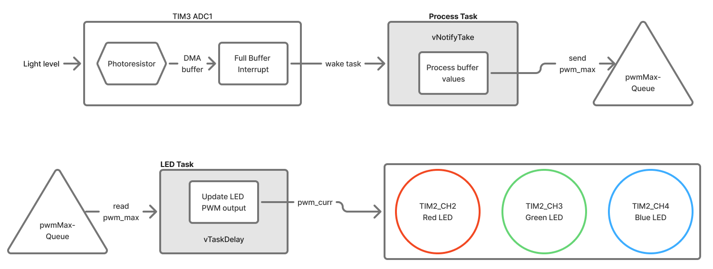

# RTOS Nightlight

**Laurel Cox**, Embedded Software FA26

## Overview

For Mini Project 3 in my Embedded Software course, I was tasked with refactoring an old project into one with RTOS infastructure. I choose to use [my night light project](!https://github.com/olincollege/embd-nightlight-cox/tree/main) because it has interrupts, an ADC conversion and multiple timers. While it's not a super complicated system...

- it's components have reasonable application to RTOS (acquiring & processing live data, shared data, coordinating peripherals)
- and is well scoped for this RTOS exploration and has the necessary components to fulfill the project requirements.

**[See demo video here!](https://youtube.com/shorts/24WjEagzktA?feature=share)**

## RTOS System Architecture

_Architecture Diagram_

In my RTOS architecture, I've implemented 2 tasks, one for processing the DMA buffer and one for handling LED fading/brightness. The Process Task has a slightly higher priority than the LED task because it's woken by an interrupt and we must process the buffer before it's overwritten. And a queue is implemented to handle the inter-task data transfers.

### Process Task

In my original architecture, the processing code lived in my DMA buffer interrupt. In my new architecture, the processing code is in the Process Task and is "woken up" by the `vTaskNotifyGiveFromISR` function when an interrupt executes when the DMA buffer is full. Separating the processing from the interrupt is advantageous because it makes the interrupt even lighter than before.

The Process Task averages the buffer and does some manipulation to calculate the `pwm_max` value, which is the ceiling for our LED PWM output. The `pwm_max` value must be shared with our LED Task, so I use a 1-slot queue called `pwmMaxQueue` to safely send the value. Additionally, to ensure the most updated value is in the queue, I use the `xQueueOverwrite` function when writing to the queue. I don't use a multiple-slot queue because the most recent detected lighting level is what the nightlight should respond to.

### LED Task

In my original architecture, the LED handling code ran on a timer with each tick increasing/decreasing the LED PWM with the variable `pwm_curr`. In my new architecture this is it's own periodic task. I use the `vTaskDelay` function with a 180ms delay to simulate a step of the timer. The task processes "pwm_max" by reading off of the `pwmMaxQueue`. If the queue is empty, the task can still proceed with inc/dec towards the last read `pwm_max` value. Then, when there is a message on the queue, the task can update it's local version of `pwm_max`.

## Consequence of RTOS

A drawback of my RTOS infastructure is related to the LED fading timing. Now that the LED fading is handled by a task instead of on a timer, the timing for LED fade might see a little delay and not actually fire exactly every 180ms. Even though the LED task is preempted by the higher priority Process Task, the Process Task is light enough not have a disruptive or noticeable impact on the fading of the LEDs. While my nightlight system doesn't have strict and tight timing requirements, it is something to consider in projects with those reqs.
